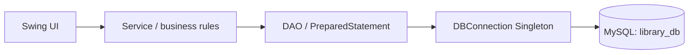

# Library Management System

A Java desktop application for managing a library catalogue, members, circulation, reservations, fines, and reports. It uses Swing/AWT, JDBC, and MySQL, and is organized as a NetBeans Java-with-Ant project.

## Features

- Librarian sign-in, dashboard statistics, book and member administration, issue/return, reservations, fine management, reports, profile/password tools, and logout.
- Student and faculty registration with librarian approval; members can search the catalogue and view their own borrowed books, history, reservations, and fines.
- Member-specific borrowing limits, loan periods, and overdue fine rates.
- Reference books cannot be issued. A member cannot hold two active issues of the same book, and borrowing is restricted for pending/blocked members or members whose unpaid fines exceed ₹100.
- FIFO reservation queue. On return, the oldest eligible waiting member receives a `READY` hold; cancellation or claiming a hold updates the queue and availability.
- Searchable reports and printable report tables.
- JDBC work is performed through DAOs and services; Swing screens use `SwingWorker` for background operations. Issue/return use per-book JVM locks and MySQL row locks.

## Technology and requirements

- JDK 17 or newer; compilation targets Java 17 via `--release 17`.
- Apache NetBeans Java-with-Ant project and Apache Ant 1.10 or newer.
- Swing/AWT and Java2D; MySQL Server 8.0; JDBC.
- MySQL Connector/J at `lib/mysql-connector-j.jar`, referenced with a project-relative path.
- The application has no JavaFX, Maven, Tomcat, or ORM dependency.

## Architecture



UI classes delegate business logic to services. DAOs own SQL and row mapping; `DBConnection` obtains JDBC connections using `src/db.properties`.

## Project structure

```text
Library-Management-System/
├── build.xml                         Ant targets and project customizations
├── manifest.mf                       Executable JAR manifest
├── library_schema.sql                Database, tables, seed account, DB user
├── .gitignore
├── README.md
├── lib/
│   └── mysql-connector-j.jar          JDBC driver
├── nbproject/
│   ├── build-impl.xml                 NetBeans Ant implementation
│   ├── genfiles.properties
│   ├── project.properties
│   └── project.xml
└── src/
    ├── db.properties                 Local JDBC settings
    └── library/management/system/
        ├── dao/                       Book, member, user, issue, fine,
        │                              reservation, and report DAOs
        ├── db/                        DBConnection, DatabaseTransaction,
        │                              SchemaMigrator
        ├── exception/                 Checked library exceptions
        ├── item/                      LibraryItem hierarchy and item factory
        ├── member/                    Person/member hierarchy and factory
        ├── model/                     Domain objects and enums
        ├── service/                   Authentication, circulation, rules,
        │                              reports, reservations, scheduled work
        ├── ui/                        Swing screens and shared frames
        └── util/                      Validation, password, date, ID,
                                       background-task, and table helpers
```

## Setup

### Install tools and driver

Install JDK 17+, MySQL 8.0, Apache Ant 1.10+, and NetBeans with Java/Ant support. Keep Connector/J at:

```text
lib/mysql-connector-j.jar
```

The JAR is included in this project. If it is missing from your copy, obtain the MySQL Connector/J driver and place it at that exact relative path. `nbproject/project.properties` references it; the packaged application expects the driver at `dist/lib/mysql-connector-j.jar` beside the application JAR.

### Create the database

Start MySQL, then run `library_schema.sql` once as an account permitted to create a database and user and grant privileges. In MySQL Workbench, open the file and execute it. Or, from the MySQL monitor, use the actual project path, for example:

```sql
SOURCE D:/Library-Management-System/library_schema.sql;
```

The script creates `library_db`, its tables and indexes, seeds the default active librarian if the account is absent, and creates/grants the local application account `libuser`@`localhost`.

### Configure `db.properties`

The project file `src/db.properties` currently contains these local defaults:

```properties
db.url=jdbc:mysql://localhost:3306/library_db?useSSL=false&allowPublicKeyRetrieval=true
db.user=libuser
db.password=YOUR_DB_PASSWORD
```

Change these values if your MySQL setup differs. Keep database credentials out of Java source. Ant copies this file to the runtime classpath during compilation. The supplied account and password are development defaults; use suitable credentials for any non-local deployment.

## Build and run

From PowerShell or a terminal at the project root:

```text
ant clean
ant compile
ant jar
```

Plain `ant` runs the default project build, including Javadoc generation. `ant migrate` runs the additive schema migration and requires a database account with the needed ALTER privilege.

In NetBeans, open the project folder, choose **Clean and Build**, then **Run**. The configured main class is `library.management.system.Main`. Alternatively, run the executable JAR after building:

```text
java -jar dist/Library-Management-System.jar
```

The JAR manifest sets `Main-Class: library.management.system.Main` and uses the relative driver path `lib/mysql-connector-j.jar`.

## Default login and borrowing rules

The SQL seed documents and inserts the default librarian account **admin / admin123**. It is active and uses the password hash and salt format expected by the application. Change the default password for any shared or non-local use.

| Member type | Maximum active issues | Default loan period | Fine per overdue day |
|---|---:|---:|---:|
| Student | 3 | 14 days | ₹5 |
| Faculty | 10 | 30 days | ₹2 |

The issue service also accepts a requested loan duration where provided by its caller. Other implemented rules include: reference books are not issuable; pending or blocked members cannot borrow or reserve; unpaid fines above ₹100 block borrowing; a member cannot issue the same title twice at once; reservations are for unavailable copies; and available-copy changes are protected by transactions and database constraints.

## Data model and security

`library_schema.sql` defines these tables:

- `users`: login identity, role/status, contact details, salted password hash.
- `members`: member ID, user relationship, member type, department, approval data.
- `books`: catalogue details, item/reference indicator, total and available copies.
- `issues`: member/book circulation dates and issue status.
- `reservations`: member/book queue entries and `WAITING`, `READY`, `FULFILLED`, or `CANCELLED` status.
- `fines`: issue/member relationship, days late, amount, and paid/unpaid status.

The schema uses primary/foreign keys, unique constraints and indexes, and checks for valid copy/fine values. DAO queries use JDBC prepared statements. Passwords are salted and hashed with SHA-256 by `util/PasswordUtil.java`; database queries stay in the DAO layer. Issue and return operations use transactions with rollback handling and `SELECT ... FOR UPDATE`; `service/IssueService.java` adds a per-book `ConcurrentHashMap` lock.

## Design and implementation notes

- **Inheritance and polymorphism:** `model/Person.java` is the parent of `member/Librarian.java` and `member/Member.java`; `StudentMember` and `FacultyMember` extend `Member`. `item/LibraryItem.java` is the parent of `Book`, `ReferenceBook`, and `Magazine`.
- **Interfaces and factories:** `item/Borrowable.java`, `item/Reservable.java`, and `dao/GenericDAO.java`; `member/MemberFactory.java` and `item/ItemFactory.java` return parent types.
- **Template Method:** `ui/AbstractAsyncTableFrame.java` defines asynchronous fetch/render steps reused by `BorrowingHistoryFrame` and `FineManagementFrame`. `ui/BaseFrame.java` shares common window UI behavior; `SplashScreen` is a separate `JFrame`.
- **Checked exceptions and enums:** `exception/LibraryException.java` and its checked subclasses; `model/Role`, `MemberType`, `ItemCategory`, `IssueStatus`, and `MemberStatus`.
- **Collections and generics:** `GenericDAO<T,K>` is implemented by the table DAOs and returns `Optional` from ID lookups. `BookService` uses sets for ISBN checks; `ReportService` uses `HashMap`, `EnumMap`, and `TreeMap`; `ReservationService` uses a `PriorityQueue`; services use streams. `DatabaseTransaction` provides a generic JDBC callback, and `TableModelBuilder<T>` builds typed table models. `BackgroundTask<T>` exists as a `SwingWorker` helper; screens also instantiate typed `SwingWorker`s directly.
- **Concurrency:** `IssueService` coordinates per-book operations; `IssueDAO` keeps database row locking. `OverdueMonitor` schedules status/fine refresh once per minute. `FineService` uses an `ExecutorService` to calculate overdue fines in parallel. Dashboard clocks and splash loading behavior are implemented in the UI classes.
- **JDBC and persistence:** `db/DBConnection.java` provides connection access; the `dao` package contains table-specific persistence. `MemberDAO` performs registration persistence transactionally; issue and return operations are transactional in `IssueDAO`.

## Testing status and known limitations

- Build verification recorded on 2026-10-09: `ant clean`, `ant compile`, `ant jar`, and plain `ant` succeeded. Compilation used `--release 17`; Javadoc generation succeeded with documentation warnings (100 warnings were reported in the recorded run).
- No automated test source tree is included in this project. These build results do not establish that every MySQL workflow, screen, or business rule has passed an end-to-end test. Run the application against a disposable/test database before making changes to real library data.
- Earlier targeted database checks were performed during development, but are not bundled as a repeatable test suite.
- `Magazine` is implemented in the `LibraryItem` hierarchy and `ItemFactory`; the current `books` persistence and catalogue UI do not provide separate magazine-specific storage/management.
- NetBeans clean/build and GUI layout should be checked on the target machine and screen configuration before final presentation.

## Troubleshooting

| Problem | Check |
|---|---|
| `db.properties` not found | Keep `src/db.properties` in place and rebuild so Ant copies it to `build/classes`. |
| Unknown database | Run `library_schema.sql` against the intended MySQL server. |
| Access denied for `libuser` | Verify `db.properties`; rerun the schema script as a privileged local MySQL account if appropriate. |
| Connector/J driver not found | Confirm `lib/mysql-connector-j.jar` exists and the relative path in `nbproject/project.properties` is unchanged. |
| Migration permission error | Run `ant migrate` with a database account allowed to perform the required schema alteration. |
| Librarian login fails | Confirm the seed row exists and use `admin` / `admin123`; check server availability and JDBC settings. |
| JAR cannot load the JDBC driver | Keep `dist/lib/mysql-connector-j.jar` beside `dist/Library-Management-System.jar`. |
| Build reports Javadoc warnings | Javadoc is generated by plain `ant`; warnings concern incomplete API comments and do not necessarily indicate build failure. |

## Rubric mapping

| Original rubric requirement | Relevant implementation |
|---|---|
| OOP: polymorphism, inheritance, exception handling, interfaces (10 marks) | `Person`, `Librarian`, abstract `Member`, `StudentMember`, `FacultyMember`; `LibraryItem`, `Book`, `ReferenceBook`, `Magazine`; `Borrowable`, `Reservable`; checked exception hierarchy under `LibraryException`; `MemberFactory`, `ItemFactory`. |
| Collections and generics (6 marks) | `GenericDAO<T,K>` and typed DAO implementations; `Optional` lookup methods; `BookService` set-based ISBN handling; `ReportService` maps; `ReservationService` queue; stream-based service filtering; generic `DatabaseTransaction`, `TableModelBuilder<T>`, and `BackgroundTask<T>`. |
| Multithreading and synchronization (4 marks) | `SplashScreen` loading thread; dashboard clock code in `LibrarianDashboardFrame` and `MemberDashboardFrame`; `SwingWorker` UI operations; `OverdueMonitor` scheduler; `FineService` executor pool; `IssueService` keyed book locks plus `IssueDAO` row locks; synchronized `MemberIdGenerator.nextId()`; synchronized singleton access in `DBConnection`. |
| Classes for database operations (7 marks) | `dao/GenericDAO.java`; `BookDAO`, `MemberDAO`, `UserDAO`, `IssueDAO`, `ReservationDAO`, `FineDAO`, `ReportDAO`; connection and transaction helpers under `db/`. |
| Database connectivity (3 marks) | `db/DBConnection.java`, `src/db.properties`, `library_schema.sql`, `lib/mysql-connector-j.jar`. |
| JDBC implementation (3 marks) | DAO prepared statements, result-set mapping, generated keys, report queries, and transactional registration/issue/return operations; MySQL schema and default seed account in `library_schema.sql`. |

| Project brief section | Where to inspect |
|---|---|
| Technology and NetBeans Ant project | `nbproject/project.xml`, `nbproject/project.properties`, `nbproject/build-impl.xml`, `build.xml`, `manifest.mf`. |
| Architecture and packages | `ui/`, `service/`, `dao/`, `db/`, `model/`, `item/`, `member/`, `exception/`, `util/`. |
| Librarian/member features | Screen classes under `ui/`; business rules and persistence under `service/` and `dao/`. |
| Business rules | `model/MemberType.java`, `member/StudentMember.java`, `member/FacultyMember.java`, `service/IssueService.java`, `service/ReservationService.java`, `library_schema.sql`. |
| OOP hierarchy, factories, exceptions, enums, template | Domain packages listed above; `ui/BaseFrame.java`, `ui/AbstractAsyncTableFrame.java`. |
| Collections, generics, optional and streams | `dao/GenericDAO.java`, `service/BookService.java`, `service/ReportService.java`, `service/ReservationService.java`, `db/DatabaseTransaction.java`, `util/TableModelBuilder.java`. |
| Threads, jobs and synchronization | `ui/SplashScreen.java`, dashboard frames, `service/OverdueMonitor.java`, `service/FineService.java`, `service/IssueService.java`, `dao/IssueDAO.java`, `util/MemberIdGenerator.java`, `db/DBConnection.java`. |
| Schema, JDBC, transactions, password handling | `library_schema.sql`, DAO classes, `db/DBConnection.java`, `db/DatabaseTransaction.java`, `util/PasswordUtil.java`. |
| UI, validation and reports | `ui/UITheme.java`, `ui/BaseFrame.java`, `ui/ReportFrame.java`, `util/Validator.java`, `util/MessageUtil.java`. |
| Code quality and testing | Checked exceptions under `exception/`; no automated test sources are currently included. Build/test status is stated above. |
| Delivery files and run steps | This README, `.gitignore`, `src/db.properties`, `library_schema.sql`, `lib/mysql-connector-j.jar`, and NetBeans/Ant files listed above. |

